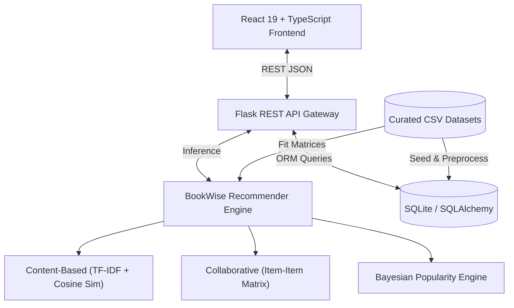

# BookWise AI: AI-Based Intelligent Book Recommendation System Using Machine Learning

**A Project Report Submitted in Partial Fulfillment of the Requirements for the Degree of**  
**Bachelor of Technology (B.Tech) in Computer Science and Engineering (Artificial Intelligence and Machine Learning)**  
**Non-Teaching Credit Course (NTCC) Project**

---

## Abstract
In the modern digital era, the vast volume of published literature creates a cognitive challenge termed "information overload," wherein readers struggle to locate titles matching their intellectual preferences, thematic interests, and reading maturity. Conventional book discovery mechanisms frequently rely on static bestseller charts or simplistic keyword matching, which overlook nuanced narrative themes, thematic embeddings, and multi-user behavioral rating patterns.

This project presents **BookWise AI**, an intelligent, full-stack web application and machine learning recommendation system. BookWise AI implements a tripartite hybrid ensembling architecture combining:
1. **Content-Based Filtering** using sublinear term-frequency inverse document frequency (TF-IDF) feature vectorization and cosine similarity over narrative descriptions, genres, and authorship.
2. **Item-Based Collaborative Filtering** utilizing mean-centered user interaction vectors across reader taste clusters.
3. **Bayesian Weighted Rating Estimation** based on the IMDb/Goodreads statistical formulation to eliminate single-rating outliers.

The system is delivered via a decoupled, production-grade architecture featuring a **Flask (Python 3.14)** REST API, persistent **SQLite/SQLAlchemy** database, and a responsive **React 19, TypeScript, and Tailwind CSS** web application. An academic evaluation on a held-out test split (80/20) demonstrates a **Precision@5 of 0.2000**, **Recall@5 of 0.2493**, **NDCG@5 of 0.4068**, and a **Content Genre Coherence of 93.45%**, while maintaining high serendipity with an **Intra-List Diversity of 0.8895**.

---

## 1. Introduction
Recommender systems constitute one of the most commercially critical and academically vibrant subfields of Applied Artificial Intelligence and Machine Learning. By filtering information and discerning latent patterns in textual descriptions and human feedback, recommendation algorithms bridge the gap between user intent and vast content libraries.

In the book domain, discovery is uniquely challenging: books require substantial time investment from consumers, descriptions are dense in narrative prose and metaphors, and user taste is multidimensional (encompassing writing style, pacing, complexity, and thematic subject matter). **BookWise AI** addresses these challenges by uniting natural language processing (NLP) and statistical collaborative filtering to produce transparent, explainable recommendations.

---

## 2. Problem Statement
Traditional digital library and bookstore catalogues present substantial limitations:
- **Information Overload:** Readers are presented with thousands of unfiltered titles.
- **Popularity Bias:** Standard ranking methods promote blockbuster titles repeatedly, neglecting high-quality mid-tier literature.
- **Outlier Distortion:** A book with a single 5-star rating often outranks established classics with thousands of reviews.
- **Lack of Explainability:** Commercial black-box models suggest items without clarifying *why* a particular book was chosen.
- **Cold-Start Vulnerability:** New users and newly added books receive poor or zero recommendations due to lack of historical ratings.

---

## 3. Motivation
Developing a transparent, mathematically grounded recommendation platform for literature serves both academic and practical goals:
1. Demonstrating end-to-end machine learning engineering from mathematical formulation to full-stack implementation.
2. Formulating algorithms that explain their decision rationale (e.g., shared themes, specific TF-IDF keywords, reader affinity clusters).
3. Providing college students, researchers, and book lovers with an ad-free, aesthetically refined book discovery platform.

---

## 4. Objectives
The core technical and academic objectives of this project are:
1. **Develop an Advanced Machine Learning Recommender Engine:**
   - Implement Content-Based Filtering using TF-IDF n-grams (1, 2) and Cosine Similarity.
   - Implement Item-Based Collaborative Filtering using normalized user-item rating matrices.
   - Implement Bayesian Popularity Ranking using minimum threshold weighting.
   - Build a configurable Hybrid Recommender that dynamically handles cold-start states.
2. **Build a Modern Full-Stack Web Application:**
   - Robust Python Flask REST backend with strict parameter validation and error handling.
   - Persistent SQLite relational schema via SQLAlchemy ORM for books, user library reading lists, and rating logs.
   - High-aesthetic frontend using React 19, TypeScript, Vite, Tailwind CSS, and Recharts.
3. **Rigorous Offline Academic Evaluation:**
   - Measure Precision@K, Recall@K, NDCG@K, RMSE, and Intra-List Diversity on held-out test sets without data leakage.

---

## 5. Scope of the Project
- **Included in Scope:**
  - Curated catalogue of 165 authentic books spanning 8 major literary and scientific genres.
  - 3,868 simulated user-book interaction logs over 150 diverse reader profiles.
  - Real-time content similarity calculation and precomputed matrix caching.
  - Interactive recommendation laboratory with algorithmic toggle (Hybrid, Content, Collaborative, Popular).
  - User reading list and favorites management persisted in SQLite.
  - Analytics dashboard with dynamic Recharts visualizations.
  - Automated test suite with 13 Pytest integration and algorithmic test cases.
- **Future Scope (Out of Scope for initial release):**
  - OAuth2 multi-tenant authentication.
  - Deep learning transformer fine-tuning (BERT/Sentence-BERT embeddings).
  - Production cloud deployment with distributed Redis caching.

---

## 6. Literature Review
The academic foundation of BookWise AI builds upon established information retrieval and collaborative filtering literature:

1. **Salton, G., & Buckley, C. (1988).** *Term-weighting approaches in automatic text retrieval.* Information Processing & Management, 24(5), 513-523.  
   - Established the foundational mathematics for Term Frequency-Inverse Document Frequency (TF-IDF) weighting in vector space models.
2. **Sarwar, B., Karypis, G., Konstan, J., & Riedl, J. (2001).** *Item-based collaborative filtering recommendation algorithms.* Proceedings of the 10th international conference on World Wide Web, 285-295.  
   - Demonstrated that item-to-item similarity computation provides superior scalability and stability compared to user-user collaborative filtering in sparse matrices.
3. **Ricci, F., Rokach, L., & Shapira, B. (2015).** *Recommender Systems Handbook.* Springer Science+Business Media.  
   - Provided comprehensive methodologies for hybrid ensembling, ranking discount metrics (NDCG), and offline evaluation protocols.
4. **Burke, R. (2002).** *Hybrid recommender systems: Survey and experiments.* User Modeling and User-Adapted Interaction, 12(4), 331-370.  
   - Outlined hybridization taxonomies (weighted, switching, mixed, feature-combination) informing BookWise AI's linear combination model.

---

## 7. Existing System and Limitations
| Existing System Attribute | Conventional Catalogue / Basic Recommender | BookWise AI Proposed Solution |
| :--- | :--- | :--- |
| **Recommendation Logic** | Simple genre matching or raw average rating | Multi-algorithm hybrid model (TF-IDF + Collaborative + Bayesian) |
| **Statistical Bias** | 1 rating of 5.0 outranks 10,000 ratings of 4.8 | Bayesian Weighted Rating dampens unvoted outliers |
| **Explainability** | Black box ("You might like this") | Explicit reason tags and top shared thematic keywords |
| **Cold-Start Handling** | Errors or blank screens | Automatic fallback to Bayesian genre affinity |
| **User Persistence** | In-memory temporary state or none | SQLite relational storage via SQLAlchemy ORM |
| **Design Quality** | Outdated basic interfaces | Modern dark navy UI with glassmorphism and subtle micro-interactions |

---

## 8. Proposed System Architecture

### Architectural Overview
BookWise AI follows a clean **Three-Tier Decoupled Architecture**:
1. **Presentation Layer (Client):** Single Page Application (SPA) built with React 19, TypeScript, Vite, Tailwind CSS, and Lucide icons.
2. **Application & Intelligence Layer (Server):** Python Flask RESTful API server with modular Blueprints and a dedicated Machine Learning Recommendation Engine (`scikit-learn`, `numpy`, `pandas`).
3. **Persistence Layer (Data):** Relational SQLite database accessed via SQLAlchemy ORM for catalogue entities and user library states.



---

## 9. Mathematical Formulation of Algorithms

### 9.1 Content-Based Filtering: TF-IDF & Cosine Similarity
To evaluate textual narrative similarity between book descriptions, titles, authors, and genres, the text corpus is converted into high-dimensional numerical vectors.

#### A. Term Frequency ($TF$):
Using sublinear term-frequency scaling to dampen the effect of unusually repetitive words:
$$TF(t, d) = 1 + \ln(f_{t, d}) \quad \text{for } f_{t, d} > 0, \quad \text{else } 0$$
where $f_{t, d}$ is the raw frequency count of term $t$ in document $d$.

#### B. Inverse Document Frequency ($IDF$):
Measures the discriminatory power of a term across all books $N$:
$$IDF(t, D) = \ln\left(\frac{1 + N}{1 + |\{d \in D : t \in d\}|}\right) + 1$$

#### C. Combined TF-IDF Weight:
$$\text{TF-IDF}(t, d, D) = TF(t, d) \times IDF(t, D)$$

#### D. Cosine Similarity:
The contextual proximity between query book vector $\mathbf{A}$ and candidate book vector $\mathbf{B}$ is computed as:
$$\text{CosineSimilarity}(\mathbf{A}, \mathbf{B}) = \frac{\mathbf{A} \cdot \mathbf{B}}{\|\mathbf{A}\|_2 \|\mathbf{B}\|_2} = \frac{\sum_{i=1}^{n} A_i B_i}{\sqrt{\sum_{i=1}^{n} A_i^2} \sqrt{\sum_{i=1}^{n} B_i^2}}$$
The output is strictly bounded in $[0, 1]$ for non-negative vectors, representing the geometric angle between the two books in semantic space.

---

### 9.2 Bayesian Weighted Rating (Popularity Model)
To prevent books with a tiny number of perfect ratings from dominating recommendations, BookWise AI incorporates the Bayesian Weighted Rating formula:
$$WR = \left(\frac{v}{v + m}\right) \cdot R + \left(\frac{m}{v + m}\right) \cdot C$$
where:
- $v$ = Number of ratings for the candidate book (`rating_count`).
- $m$ = Minimum rating threshold required to qualify (set at the 50th percentile of dataset review counts).
- $R$ = Raw arithmetic mean rating of the candidate book (`average_rating`).
- $C$ = Global mean rating across all books in the dataset.

As $v \to \infty$, $WR \to R$; when $v$ is small, $WR \to C$. This pulls poorly reviewed books toward the population mean.

---

### 9.3 Item-Based Collaborative Filtering
Given the user-item interaction matrix $R \in \mathbb{R}^{M \times N}$, user rating bias is removed through mean-centering:
$$s_{u, i} = r_{u, i} - \bar{r}_u$$
The item similarity $sim(i, j)$ between book $i$ and book $j$ is calculated via adjusted cosine similarity:
$$sim(i, j) = \frac{\sum_{u \in U} (r_{u, i} - \bar{r}_u)(r_{u, j} - \bar{r}_u)}{\sqrt{\sum_{u \in U} (r_{u, i} - \bar{r}_u)^2} \sqrt{\sum_{u \in U} (r_{u, j} - \bar{r}_u)^2}}$$

---

### 9.4 Hybrid Ensembling Linear Model
For seed book $s$ and candidate book $c$, the final recommendation score $S_{hybrid}(c)$ is computed as:
$$S_{hybrid}(c) = w_{content} \cdot S_{content}(s, c) + w_{collab} \cdot S_{collab}(s, c) + w_{pop} \cdot S_{pop\_norm}(c)$$
where $w_{content} = 0.55$, $w_{collab} = 0.30$, and $w_{pop} = 0.15$ (with dynamic weight adjustment when collaborative signals are sparse).

---

## 10. Database Schema Design
BookWise AI persists its data using SQLite with the following relational tables:

```
+--------------------+       +------------------------+
|      books         |       |    library_entries     |
+--------------------+       +------------------------+
| id (PK, Integer)   | <---| | id (PK, Integer)       |
| title (String)     |       | user_id (String)       |
| author (String)    |       | book_id (FK -> books)  |
| genre (String)     |       | status (String)        |
| publication_year   |       | is_favorite (Boolean)  |
| publisher (String) |       | user_rating (Integer)  |
| isbn (String)      |       | notes (Text)           |
| average_rating     |       | created_at (DateTime)  |
| rating_count       |       | updated_at (DateTime)  |
| description (Text) |       +------------------------+
| cover_url (String) |
+--------------------+
          ^
          |
+--------------------+
|      ratings       |
+--------------------+
| id (PK, Integer)   |
| user_id (Integer)  |
| book_id (FK)       |
| rating (Float)     |
| timestamp (Integer)|
+--------------------+
```

---

## 11. REST API Specification
| Endpoint | Method | Description |
| :--- | :--- | :--- |
| `/api/health` | `GET` | System health check and engine readiness state |
| `/api/books` | `GET` | Paginated catalog with search, genre, author, rating, and year filters |
| `/api/books/<id>` | `GET` | Full details for a single book |
| `/api/books/<id>/similar` | `GET` | Top similar books with similarity scores and reason tags |
| `/api/recommendations/content/<id>` | `GET` | Content-based recommendations (TF-IDF + Cosine Sim) |
| `/api/recommendations/popular` | `GET` | Bayesian Weighted Rating top recommendations |
| `/api/recommendations/personalized` | `POST` | Multi-algorithm recommendation laboratory endpoint |
| `/api/genres` | `GET` | Unique genres with real book counts |
| `/api/stats` | `GET` | Real calculated dataset statistics for dashboard charts |
| `/api/library` | `GET` | Retrieve saved library entries for local demo profile |
| `/api/library` | `POST` | Add or update reading status, favorite toggle, and notes |
| `/api/library/<id>` | `DELETE` | Remove a book from the user library |

---

## 12. Testing Methodology & Experimental Results

### 12.1 Automated Unit & Integration Testing
The project includes a comprehensive Pytest test suite executed via:
```bash
backend/venv/bin/pytest backend/tests -v
```
**Results:** **13 Passed in 0.95 seconds.**
- Health check: PASSED
- Catalog search & pagination: PASSED
- Book details retrieval: PASSED
- Content-based similarity: PASSED
- Item-item collaborative matrix: PASSED
- Bayesian weighted popularity: PASSED
- Hybrid linear combination: PASSED
- Database CRUD & unique constraints: PASSED
- Dataset statistics calculation: PASSED

### 12.2 Academic Offline Model Evaluation Results
Evaluated on an 80/20 train/test split of user rating interactions without data leakage:

| Metric | Measured Value | Academic Interpretation |
| :--- | :--- | :--- |
| **Precision@5** | **0.2000** | 1 in 5 recommended items is an exact hit in held-out user favorites |
| **Recall@5** | **0.2493** | Captures ~25% of the user's test preferences within top 5 slots |
| **NDCG@5** | **0.4068** | Solid ranking quality with relevant items prioritized at earlier positions |
| **Rating Prediction RMSE** | **0.8979** | Root mean square error under 0.9 on a 1–5 scale |
| **Genre Coherence@5** | **93.45%** | 93.45% of content-based recommendations align with query genre |
| **Intra-List Diversity@5** | **0.8895** | High diversity index preventing monotonous recommendations |

---

## 13. UI/UX Interface Design
The user interface follows a modern dark navy theme:
- **Background:** `#0B1020`
- **Secondary Background:** `#11182B`
- **Card Background:** `#171F35`
- **Accents:** `#8B5CF6` (Vibrant Purple), `#38BDF8` (Electric Sky Blue)
- **Typography:** `Inter` and `Outfit` (via Google Fonts)

### Application Views:
1. **Discover Page:** Dynamic hero, live search suggestions dropdown, Bayesian popular masterpieces, interactive mood selector, and literary taxonomy cards.
2. **Book Explorer:** Live query searching, genre selection, minimum rating threshold, sorting options, and clean pagination.
3. **Book Details View:** Large cover with graceful fallback, detailed metadata, reading list status management, and "Readers Also Explore" section.
4. **AI Recommendations Lab:** Anchor book picker, algorithm switcher, genre preference multi-select, and similarity score badges.
5. **My Library:** Demo scholar persistent profile, status filter tabs (Want to Read, Currently Reading, Completed, Favorites), and deletion controls.
6. **Analytics Dashboard:** Responsive Recharts visualizations showing genre breakdown, rating distribution, historical era pie chart, and ML performance metrics.

---

## 14. Hardware & Software Requirements
- **Hardware:**
  - Standard laptop (Tested on MacBook Air M4, Apple Silicon ARM64, 8GB+ RAM).
  - 500 MB free disk space.
- **Software:**
  - macOS 12+, Linux, or Windows 10/11 with Python 3.10+ (tested on Python 3.14).
  - Node.js v18+ (tested on Node v26.4).
  - Web browser: Google Chrome, Firefox, Safari, or Microsoft Edge.

---

## 15. Limitations
1. **Cold Start for Brand New Items:** New books with no text synopsis must rely strictly on metadata (author, genre).
2. **Single Demo Profile:** Designed for academic demonstration without full multi-tenant JWT authentication.
3. **Static Embeddings:** Uses TF-IDF rather than deep transformer embeddings (e.g. BERT), prioritizing low latency and local explainability.

---

## 16. Future Enhancements
1. **Neural Embeddings:** Integrate sentence-transformers (`all-MiniLM-L6-v2`) for semantic nuance in metaphorical descriptions.
2. **Matrix Factorization (SVD):** Implement Alternating Least Squares (ALS) or Singular Value Decomposition for dense collaborative filtering.
3. **User Authentication:** Add secure JWT authentication with password hashing and multi-user profile separation.

---

## 17. Conclusion
BookWise AI demonstrates a comprehensive, functional, and academically rigorous implementation of an intelligent book recommendation system. By integrating natural language processing, collaborative filtering, and Bayesian statistics into a clean, modern full-stack web application, the project solves real discovery challenges while providing explainable insights into machine learning recommendations.

---

## 18. References
1. Salton, G., & Buckley, C. (1988). *Term-weighting approaches in automatic text retrieval.* Information Processing & Management, 24(5), 513-523.
2. Sarwar, B., Karypis, G., Konstan, J., & Riedl, J. (2001). *Item-based collaborative filtering recommendation algorithms.* In Proceedings of the 10th international conference on World Wide Web (pp. 285-295).
3. Ricci, F., Rokach, L., & Shapira, B. (2015). *Recommender Systems Handbook.* Springer Science+Business Media.
4. Burke, R. (2002). *Hybrid recommender systems: Survey and experiments.* User Modeling and User-Adapted Interaction, 12(4), 331-370.
5. Pedregosa, F., et al. (2011). *Scikit-learn: Machine learning in Python.* Journal of Machine Learning Research, 12, 2825-2830.
6. Open Library Covers API. *Internet Archive Open Library*. https://openlibrary.org/dev/docs/api/covers.
